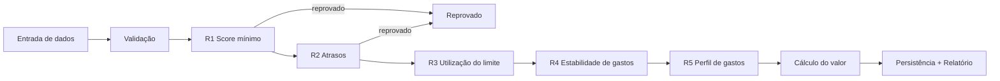
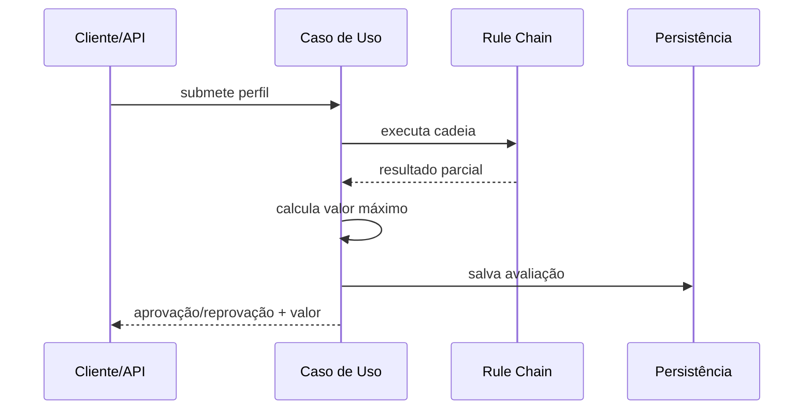
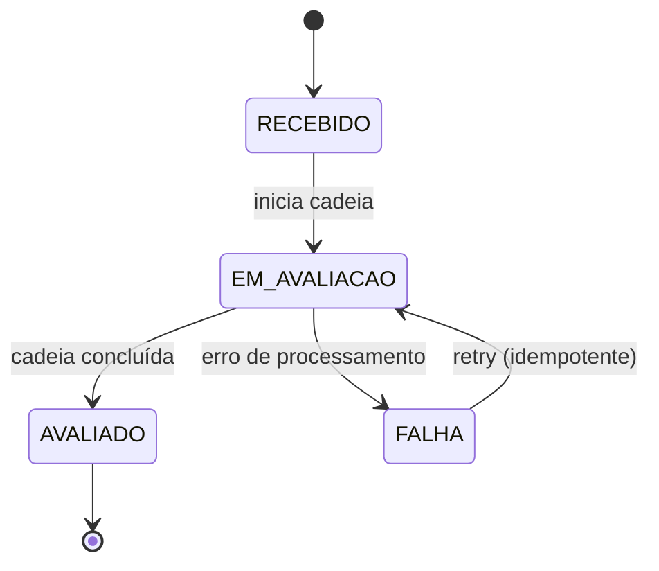
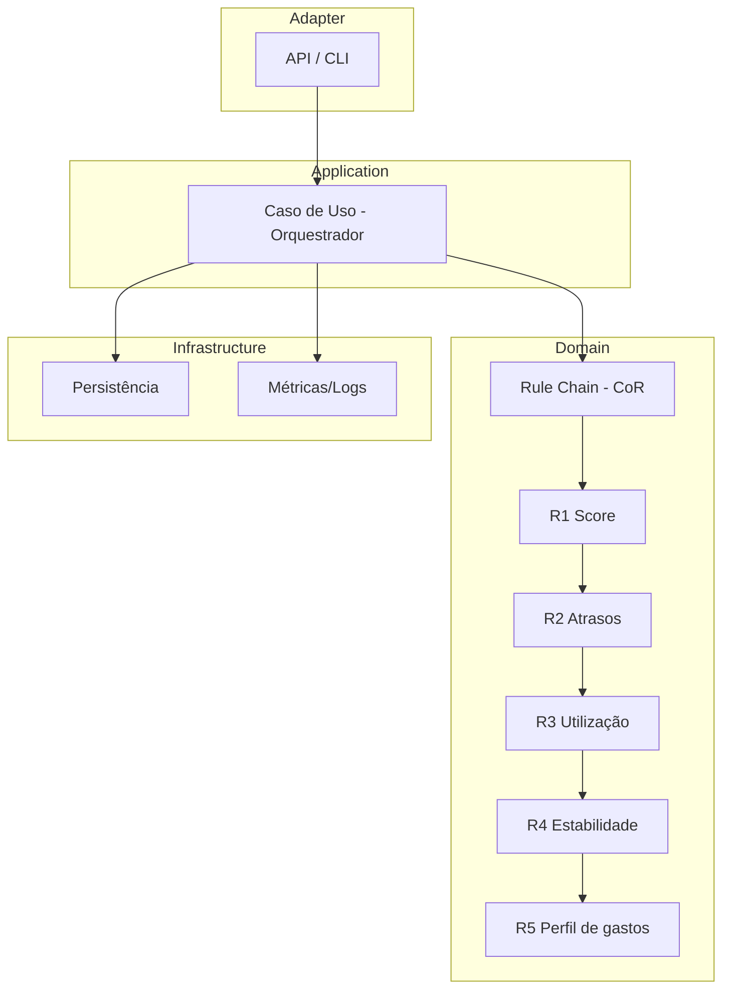

# 2. Arquitetura

## 2.1 Diagramas

Fluxo da cadeia:



Sequência:



Máquina de estados (preparação para SAGA):



Componentes:



## 2.2 Modelo de Domínio

`CustomerProfile` (domínio — dataclass frozen, `app/domain/models.py`):

```python
@dataclass(frozen=True)
class CustomerProfile:
    nome: str
    cpf_hash: str                        # SHA-256 + salt (LGPD) — hash feito no adapter
    score_credito: int                   # 0–1000
    valor_fatura: Decimal                # >= 0
    limite_disponivel: Decimal           # >= 0
    atrasos_meses: int                 # >= 0 (qtd. de meses com atraso, 0..n)
    gastos_ultimos_meses: list[Decimal]  # 6–12 meses, >= 0

    # __post_init__: validações fail-fast (nome, score 0–1000, valores >= 0, 6–12 meses de gastos)

    @property
    def limite_total(self) -> Decimal:   # premissa: fatura = saldo atual do cartão
        return self.valor_fatura + self.limite_disponivel

    @property
    def utilizacao_limite(self) -> Decimal:   # insumo da R3
        total = self.limite_total
        return Decimal("0") if total == 0 else self.valor_fatura / total

    @property
    def variacao_gastos(self) -> Decimal:     # coef. de variação (dp/média) — insumo da R4
        media = sum(self.gastos_ultimos_meses) / len(self.gastos_ultimos_meses)
        if media == 0:
            return Decimal("0")
        return Decimal(str(pstdev(self.gastos_ultimos_meses))) / media
```

Decisões: dataclass frozen (domínio puro, sem framework); `Decimal` para valores; Pydantic apenas no adapter da API; validação fail-fast; propriedades derivadas para R3/R4. **`atrasos_meses` é genérico (0..n): a janela/threshold é definida na regra R2 via configuração — se a regra mudar de 12 para outro número, só o config muda, o modelo permanece.**

`EvaluationContext` (percorre a cadeia — regras o mutam diretamente; o `RuleResult` do rascunho inicial foi simplificado nessa versão):
- customer: CustomerProfile
- status: Pendente | Aprovado | Reprovado
- peso_acumulado: int (soma dos pesos das regras de scoring satisfeitas)
- motivos: list[str]
- regras_aplicadas: list[str]

`CreditEvaluation` (saída/auditoria):
- cpf_hash, estado (RECEBIDO | EM_AVALIACAO | AVALIADO), status_final, valor_liberado: Decimal, motivos, regras_aplicadas, idempotency_key, timestamp

## 2.3 Estrutura de Pastas (Ports & Adapters)

```
credito-rotativo/
├── app/
│   ├── api/                           # Adapter (FastAPI)
│   │   ├── main.py                    # POST /avaliacoes, POST /avaliacoes/batch, GET /relatorio (JSON ou CSV via Accept)
│   │   ├── csv_export.py              # content negotiation + serialização CSV (seções RESUMO/DETALHES)
│   │   └── schemas.py                 # Pydantic (request/response) com exemplos p/ Swagger
│   ├── application/                   # Caso de uso
│   │   └── avaliar_credito.py         # orquestrador: valida → monta cadeia (config) → executa → calcula valor → persiste
│   ├── domain/
│   │   ├── models.py                  # CustomerProfile, EvaluationContext, CreditEvaluation, Estado
│   │   └── rules/                     # Chain of Responsibility
│   │       ├── __init__.py            # REGISTRY + montar_cadeia()
│   │       ├── base.py                # AbstractRule: set_next()/handle()
│   │       ├── score_minimo.py        # R1 (bloqueio)
│   │       ├── historico_atrasos.py   # R2 (bloqueio)
│   │       ├── utilizacao_limite.py   # R3 (scoring)
│   │       ├── estabilidade_gastos.py # R4 (scoring)
│   │       └── perfil_gastos.py       # R5 (scoring)
│   └── infrastructure/
│       ├── config.py                  # Settings via env vars (pydantic-settings)
│       ├── persistence.py             # repositório: memória ou SQLite (config)
│       └── observability.py           # logs estruturados + métricas
├── tests/
│   ├── unit/                          # um por elo + modelos
│   ├── integration/                   # cadeia, API, persistência
│   └── performance/                   # latência e vazão (meta 10k/min)
├── Dockerfile                         # multi-stage (venv), usuário não privilegiado
├── docker-entrypoint.sh               # ajusta volume e cai para appuser
├── docker-compose.yml                 # app + volume de dados (SQLite)
├── pytest.ini
├── requirements.txt
└── README.md
```

Dependências apontam para dentro: `api → application → domain ← infrastructure` (domínio não depende de camadas externas).

## 2.4 Camadas e Chain of Responsibility

```
API/Adapter → Caso de Uso (orquestrador) → Cadeia de Regras → Persistência
```

**Chain of Responsibility** — handler abstrato:

```
AbstractRule:
  - next: Rule
  - set_next(rule): Rule
  - handle(context: EvaluationContext): EvaluationContext

  ConcreteRuleN:
  - handle(context):
      resultado = avaliar(context.customer)
      se bloqueador e reprovado → retorna reprovação (short-circuit)
      senão → acumula peso no context e repassa ao next
```

- **Short-circuit:** regras bloqueadoras (score mínimo, atrasos) reprovam imediatamente
- **Scoring:** regras de perfil acumulam pesos/pontos no `EvaluationContext`
- **Onde Strategy entraria:** se regras futuras exigirem algoritmos de cálculo intercambiáveis (fórmulas distintas de valor), o Strategy isola esses algoritmos — decisão adiada para a implementação

O design detalhado da cadeia (código) está em [03-regras-e-configuracao.md](03-regras-e-configuracao.md).

## 2.5 Evolução para SAGA (preparação)

**Decisão de escopo (ponto de apresentação):**
- **No case (teste):** Chain of Responsibility + orquestrador — a implementação mais comum e enxuta para uma avaliação read-only
- **Em produção real:** SAGA orquestrado (Temporal/Camunda/Step Functions) quando a liberação cruzar serviços transacionais (reserva de limite, contrato, notificação), com ações de compensação por passo
- **Por quê:** SAGA prematuro adiciona consistência eventual e complexidade de compensação sem benefício para um fluxo sem side effects; 2PC/XA é evitado em escala por fragilidade

**Por que não SAGA na v1:** SAGA coordena transações distribuídas com ações de compensação. O fluxo atual é uma avaliação read-only (regras puras + persistência do resultado) — não há efeitos colaterais a compensar, então CoR + orquestrador basta.

**Quando SAGA faz sentido:** o fluxo passar a ter side effects transacionais em múltiplos serviços (liberar limite, gerar contrato, notificar) — aí cada passo precisa de compensação. A avaliação vira o **primeiro step** do Saga futuro.

**Seams preparados na v1 (sem over-engineering):**
1. **Orquestrador isolado** (use case) — substituível por workflow engine (Temporal/Step Functions) sem mudar as regras
2. **Máquina de estados** da avaliação (RECEBIDO → EM_AVALIACAO → AVALIADO/FALHA) persistida — permite retomada após falha
3. **Eventos de domínio** (`AvaliacaoIniciada`, `RegraAvaliada`, `AvaliacaoConcluida`) — habilitam coreografia futura
4. **Idempotency key** na submissão — retries seguros em escala
5. **Regras como funções puras** — podem virar serviços remotos sem mudar o contrato
