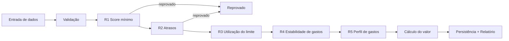
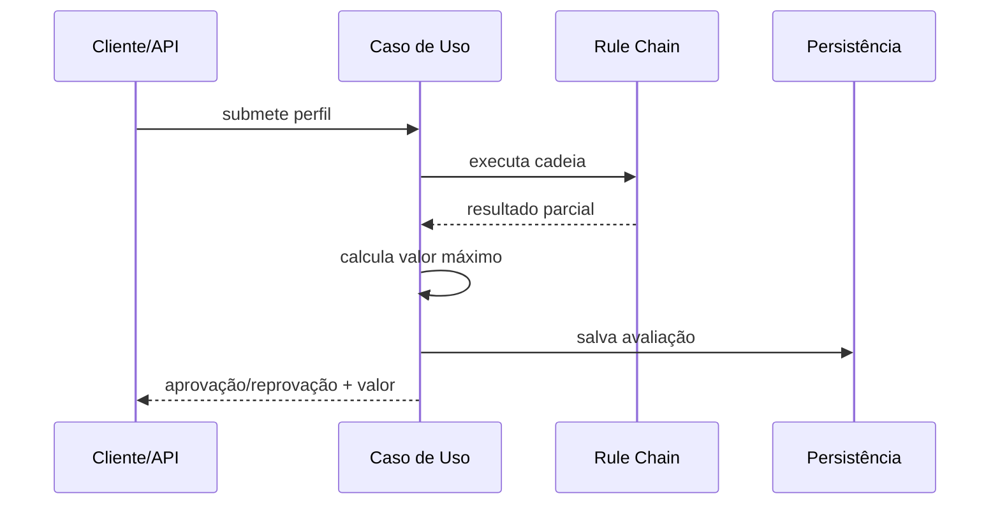
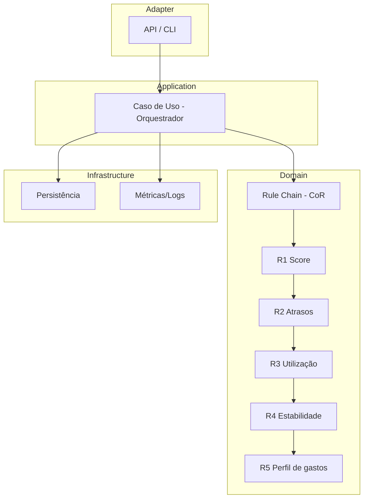

# Plano de Implementação — Sistema de Regras para Crédito Rotativo em Cartão de Crédito

**Case:** Processo Seletivo — Engenharia de Software Backend (Itaú)
**Prazo:** 7 dias corridos
**Stack:** Python 3.12 + FastAPI (API) + Pytest (testes) — escolhida por clareza, velocidade de desenvolvimento e ecossistema de testes; justificativa e trade-offs vs Java/Kotlin na seção de trade-offs
**Padrão central:** Chain of Responsibility (Strategy avaliado na implementação, se necessário)

---

## 1. Contexto

O cartão de crédito possui uma modalidade de crédito rotativo liberada automaticamente para clientes com perfil aprovado. A liberação depende de regras complexas baseadas em histórico de crédito, perfil de gastos e comportamento recente. A solução deve simular a avaliação e liberação para uma lista de clientes.

## 2. Diagramas

Fluxo da cadeia:



Sequência:



Componentes:



## 3. Modelo de Domínio e Estrutura do Projeto

### 3.1 Modelos (dataclasses / Pydantic)

`CustomerProfile` (domínio — dataclass frozen, `app/domain/models.py`):

```python
@dataclass(frozen=True)
class CustomerProfile:
    nome: str
    cpf_hash: str                        # SHA-256 + salt (LGPD) — hash feito no adapter
    score_credito: int                   # 0–1000
    valor_fatura: Decimal                # >= 0
    limite_disponivel: Decimal           # >= 0
    atrasos_meses: int                 # >= 0 (qtd. de meses com atraso, 0..n)
    gastos_ultimos_meses: list[Decimal]  # 6–12 meses, >= 0

    # __post_init__: validações fail-fast (nome, score 0–1000, valores >= 0, 6–12 meses de gastos)

    @property
    def limite_total(self) -> Decimal:   # premissa: fatura = saldo atual do cartão
        return self.valor_fatura + self.limite_disponivel

    @property
    def utilizacao_limite(self) -> Decimal:   # insumo da R3
        total = self.limite_total
        return Decimal("0") if total == 0 else self.valor_fatura / total

    @property
    def variacao_gastos(self) -> Decimal:     # coef. de variação (dp/média) — insumo da R4
        media = sum(self.gastos_ultimos_meses) / len(self.gastos_ultimos_meses)
        if media == 0:
            return Decimal("0")
        return Decimal(str(pstdev(self.gastos_ultimos_meses))) / media
```

Decisões: dataclass frozen (domínio puro, sem framework); `Decimal` para valores; Pydantic apenas no adapter da API; validação fail-fast; propriedades derivadas para R3/R4. **`atrasos_meses` é genérico (0..n): a janela/threshold é definida na regra R2 via configuração — se a regra mudar de 12 para outro número, só o config muda, o modelo permanece.**

`EvaluationContext` (percorre a cadeia):
- customer: CustomerProfile
- status: Pendente | Aprovado | Reprovado
- peso_acumulado: float
- motivos: list[str]
- regras_aplicadas: list[str]

`RuleResult` (retorno de cada elo):
- status: Aprovado | Reprovado | Neutro
- motivo: str
- peso: float

`CreditEvaluation` (saída/auditoria):
- cpf_hash, status_final, valor_liberado: Decimal, motivos, regras_aplicadas, timestamp

### 3.2 Estrutura de Pastas (Ports & Adapters)

```
credito-rotativo/
├── app/
│   ├── api/                           # Adapter (FastAPI)
│   │   ├── main.py                    # POST /avaliacoes, POST /avaliacoes/batch, GET /relatorio
│   │   └── schemas.py                 # Pydantic (request/response)
│   ├── application/                   # Caso de uso
│   │   └── avaliar_credito.py         # orquestrador: valida → monta cadeia (config) → executa → calcula valor → persiste
│   ├── domain/
│   │   ├── models.py                  # CustomerProfile, EvaluationContext, RuleResult, CreditEvaluation
│   │   └── rules/                     # Chain of Responsibility
│   │       ├── base.py                # AbstractRule: setNext()/handle()
│   │       ├── score_minimo.py        # R1 (bloqueio)
│   │       ├── historico_atrasos.py   # R2 (bloqueio)
│   │       ├── utilizacao_limite.py   # R3 (scoring)
│   │       ├── estabilidade_gastos.py # R4 (scoring)
│   │       └── perfil_gastos.py       # R5 (scoring)
│   └── infrastructure/
│       ├── config.py                  # thresholds/regras em YAML/JSON
│       ├── persistence.py             # repositório em memória (SQLite opcional)
│       └── observability.py           # logs estruturados + métricas
├── tests/
│   ├── unit/                          # um por elo
│   └── integration/                   # cadeia completa
├── requirements.txt
└── README.md
```

Dependências apontam para dentro: `api → application → domain ← infrastructure` (domínio não depende de camadas externas).

## 4. Requisitos Funcionais

- **RF1:** Receber dados fictícios de clientes (nome, CPF, score de crédito, valor da fatura atual, limite disponível, nº de atrasos, comportamento de gastos nos últimos meses)
- **RF2:** Avaliar regras que definem se o crédito rotativo pode ser liberado
- **RF3:** Calcular o valor máximo de crédito rotativo para cada cliente elegível
- **RF4:** Permitir inclusão de novas regras sem alterar a estrutura principal (Chain of Responsibility)
- **RF5:** Gerar relatório com aprovados, reprovados e respectivos valores liberados
- **RF6:** Documentar critérios de decisão e justificar as regras aplicadas

## 5. Requisitos Não Funcionais

| NFR | Meta |
|---|---|
| Latência de decisão | ≤ 1s por avaliação |
| Escalabilidade | Picos de até 10.000 avaliações/min |
| Precisão/consistência | Sem liberações indevidas ou bloqueios incorretos |
| Extensibilidade | Novas regras sem refatoração do código base |
| Segurança/LGPD | Criptografia, controle de acesso, autenticação/autorização |
| Observabilidade | Métricas, logs estruturados, alertas |
| Resiliência | Continuidade e integridade em falhas temporárias |

## 6. Arquitetura

Camadas (Ports & Adapters):

```
API/Adapter → Caso de Uso (orquestrador) → Cadeia de Regras → Persistência
```

**Chain of Responsibility** — handler abstrato:

```
AbstractRule:
  - next: Rule
  - setNext(rule): Rule
  - handle(context: EvaluationContext): RuleResult

ConcreteRuleN:
  - handle(context):
      resultado = avaliar(context.customer)
      se bloqueador e reprovado → retorna reprovação (short-circuit)
      senão → acumula peso no context e repassa ao next
```

- **Short-circuit:** regras bloqueadoras (score mínimo, atrasos) reprovam imediatamente
- **Scoring:** regras de perfil acumulam pesos/pontos no `EvaluationContext`
- **Onde Strategy entraria:** se regras futuras exigirem algoritmos de cálculo intercambiáveis (fórmulas distintas de valor), o Strategy isola esses algoritmos — decisão adiada para a implementação

## 7. Regras de Negócio Propostas (com justificativa)

| # | Regra | Tipo | Critério (exemplo) | Justificativa |
|---|---|---|---|---|
| R1 | Score mínimo | Bloqueio | score ≥ 600 | Risco de inadimplência |
| R2 | Histórico de atrasos | Bloqueio | atrasos_meses ≤ N (ex.: 2) | Comportamento de pagamento |
| R3 | Utilização do limite | Scoring | uso < 90% do limite | Sinal de estresse financeiro |
| R4 | Estilidade de gastos | Scoring | variação mês a mês < 30% | Previsibilidade de receita |
| R5 | Perfil de gastos | Scoring | fatura/renda e categorias | Capacidade de pagamento |

*Thresholds ajustáveis via configuração (YAML/JSON).*

## 8. Cálculo do Valor Máximo

```
valor = min(fatura × fator, limite × %, teto_máximo) × ajuste(score_acumulado)
```

- Fator, % e teto parametrizáveis
- Ajuste proporcional ao score acumulado na cadeia (quanto melhor o perfil, maior o valor dentro do teto)

## 9. NFRs Detalhados

- **Latência:** regras O(1), cache de regras, processamento em memória
- **Escalabilidade:** serviço stateless, fila + workers (simulados), batch
- **Segurança/LGPD:** hash com salt no CPF, criptografia de campos sensíveis, RBAC simulado, logs sem PII
- **Observabilidade:** logs estruturados (corr. ID), métricas (volume, taxa aprovação/reprovação, latência p50/p95), alertas
- **Resiliência:** retries com backoff, circuit breaker, idempotência na submissão

## 10. Extensibilidade

Nova regra = nova classe concreta de handler, registrada na configuração da cadeia. Nenhuma alteração no motor nem nas regras existentes (Open/Closed).

## 11. Estratégia de Testes

- **Unitários:** cada elo isolado (aprovado/reprovado/limite)
- **Integração:** cadeia completa, ordem e short-circuit
- **Edge cases:** score no limite, atrasos no limite, limite zerado, dados ausentes
- **Performance:** medição de latência e vazão (meta: 10k/min)

## 12. Trade-offs

- **Python + FastAPI vs Java/Kotlin:** Python maximiza clareza e velocidade (prazo de 7 dias), deixando tempo para testes, docs e NFRs; Java/Kotlin seria mais alinhado à stack do Itaú, mas mais verboso para o escopo do case
- **CoR puro vs Strategy:** CoR atende ao fluxo sequencial de avaliação; Strategy só se justifica com múltiplos algoritmos de cálculo — decisão adiada
- **Short-circuit vs avaliação completa:** reprovação imediata economiza processamento, mas perde diagnóstico completo (mitigado com log dos motivos até o ponto de corte)
- **Regras em configuração vs código:** configuração dá flexibilidade; complexidade de parsing/validação

## 13. Limitações e Evoluções

- Sem integrações reais (mocks aceitos pelo case)
- Versão inicial single-node; evoluir para fila/workers reais
- Evoluções: Strategy para cálculo, regras com ML, dashboard operacional

## 14. Entregáveis

- [ ] Documentação arquitetural (este documento)
- [ ] Diagramas (Mermaid)
- [ ] Estratégia de testes
- [ ] Justificativa de decisões e trade-offs
- [ ] Limitações e evoluções
- [ ] README com instruções (na implementação)

## 15. Declaração de Uso de IA

O uso de IA é liberado pelo case e deve ser explicitado. Registrar: uso na estruturação deste plano, exploração de padrões (CoR/Strategy) e redação da documentação — o raciocínio técnico, regras e trade-offs são do autor.

## 16. Backlog

**Epic 1 — Fundação**
- [x] Definir linguagem/stack (Python 3.12 + FastAPI + Pytest)
- [x] Estruturar camadas (adapter → use case → cadeia → persistence)
- [x] Modelar CustomerProfile e EvaluationContext

**Epic 2 — Cadeia de Regras**
- [ ] Implementar AbstractRule (setNext/handle)
- [ ] Implementar R1 e R2 (bloqueio com short-circuit)
- [ ] Implementar R3, R4, R5 (scoring com acúmulo de pesos)
- [ ] Carregar cadeia a partir de configuração

**Epic 3 — Cálculo e Relatório**
- [ ] Calcular valor máximo com ajuste por score
- [ ] Gerar relatório de aprovados/reprovados e valores

**Epic 4 — NFRs**
- [ ] Hash/criptografia de dados sensíveis (LGPD)
- [ ] Logs estruturados + métricas + alertas
- [ ] Retry/circuit breaker/idempotência (simulados)

**Epic 5 — Qualidade**
- [ ] Testes unitários por elo
- [ ] Testes de integração da cadeia
- [ ] Testes de performance (latência/vazão)

**Epic 6 — Entrega**
- [ ] Documentação final + diagramas
- [ ] README, trade-offs, limitações
- [ ] Declaração de uso de IA + preparação da apresentação (30min)
